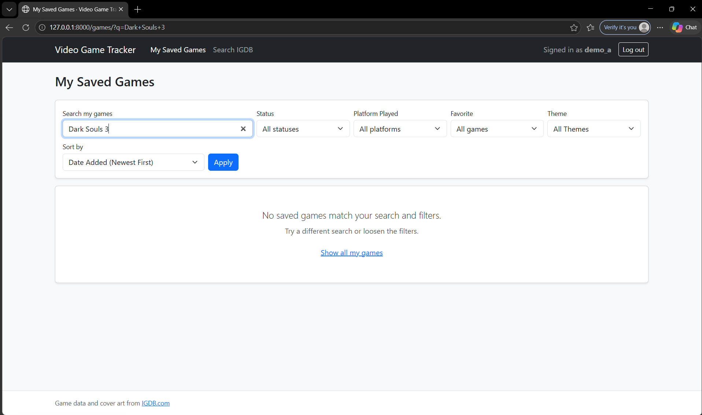
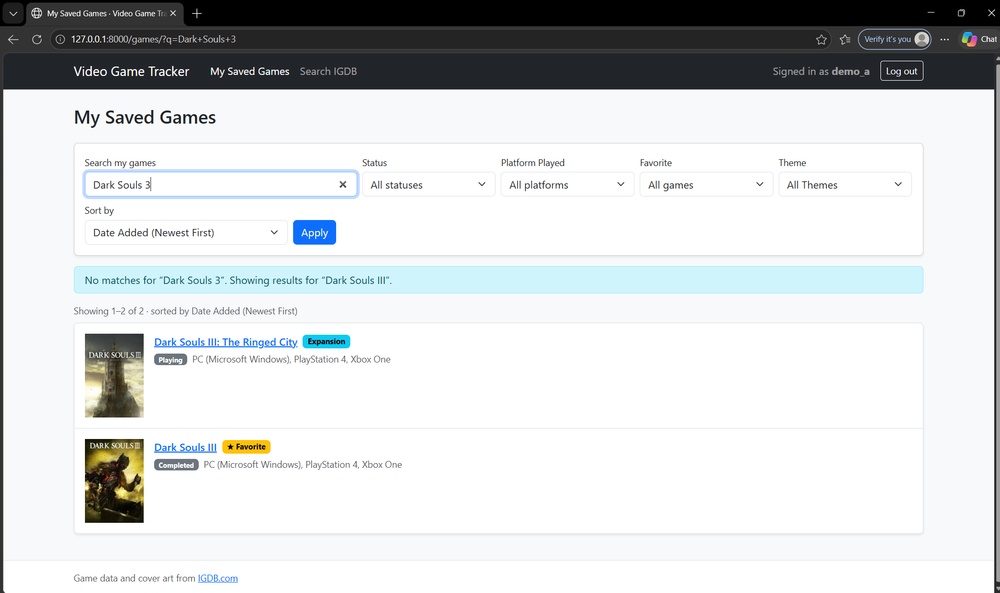

# Project #2
## Question 1:

I chose IGDB because my game tracker needed titles, release dates, platforms, summaries, and covers. I also wanted users to be able to browse their saved games when the external API was down. I considered RAWG because it only required one API key, which would have been easier to set up than Twitch authentication. The deciding factor was that IGDB’s official FAQ explicitly says its data can be stored locally. I found no equally clear guidance on local storage in RAWG’s documentation. I recorded the comparison and the open question about how Twitch’s caching terms apply to IGDB in docs/research/game-api-comparison.md, starting at line 7. IGDB API documentation and FAQ · RAWG API documentation

## Question 2:

I used the prototype to see how search, filters, sorting, and pagination would feel on My Saved Games. The prototype showed 12 games per page and had a Game Category filter with options like Expansion and Remaster. After trying it, I preferred 10 games per page, and I realized I wanted to filter by things like Horror and Survival. A live IGDB check confirmed those are themes. I recorded those decisions in prototypes/saved-games-query-state.notes.md, lines 9–20. In the finished app, games/queries.py sets the page size to 10 at line 26, and the Theme dropdown is in games/templates/games/_saved_games_region.html at line 52. Expansion and Remaster still appear as badges on individual games.

## Question 3:

I ran uv run scripts/entries_client.py update 13 Playing to update Dark Souls III: The Ringed City. In scripts/entries_client.py, lines 277–290, the script sends a GET to /api/entries/13/ to read the previous status, then sends a PATCH to the same URL with {"status": "playing"}. In config/urls.py, line 11 registers EntryViewSet under entries, and line 15 mounts the router under /api/. The script sends my token in the Authorization header at scripts/entries_client.py, line 138. DRF uses token authentication and requires an authenticated user, as configured in config/settings.py, lines 118–121. EntryViewSet.get_queryset() only looks up that user’s entries (games/api.py, lines 173–175), so someone else’s entry returns a 404. EntrySerializer validates the submitted status alongside the stored tracking values, then saves the submitted field (games/api.py, lines 108–134). The script printed Want to Play from the GET and Playing from the PATCH. I refreshed /games/13/ and confirmed it showed Playing.

## Question 4:

On My Saved Games, parse_entry_query() in games/queries.py, line 150, reads the search, filters, and sort from the URL. The query starts with entries owned by the signed-in user (games/queries.py, lines 73–75). The Q conditions on lines 248–257 are joined with OR, so a case-insensitive match in the title, summary, platform, genre, theme, or notes is enough. Lines 269–279 apply the search and the selected Status, Platform Played, Favorite, and Theme filters. .distinct() keeps an entry from showing twice when multiple related records match. Line 283 applies the selected sort, and games/views.py, lines 67–69, paginates the results at 10 per page. The template displays the entries from the current page at games/templates/games/_saved_games_region.html, line 85. In the browser, I searched Dark Souls 3. The first search found nothing, so resolve_saved_search() at games/queries.py, line 313, tried Dark Souls III and found my saved entry. The notice at games/templates/games/_saved_games_region.html, lines 75–76, explained why the result appeared while the search box still showed what I typed.

## Question 5:

One issue I found was that opening Alien: Isolation from page 2 and clicking My Saved Games sent me back to page 1. I asked Claude to keep my place so I could continue browsing from the same page. I repeated the steps after the fix and confirmed I returned to page 2. That issue is recorded in docs/verification.md starting at line 539. I also found that searching Dark Souls 3 on My Saved Games returned no matches even though I had Dark Souls III saved. Claude’s first fix covered Search IGDB, so I asked it to extend the same behavior to the saved list. I retested the search and saw the saved game and the notice explaining the alternate search term. The steps and fix are recorded in docs/verification.md starting at line 631.

